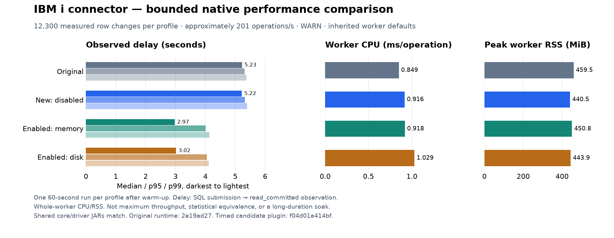

# Connector compatibility and performance comparison

This comparison describes the verified transactional-truncate candidate on
November 12, 2026. Transactional capture remains **opt-in and under review**.
An available option is not a claim that every deployment or workload has been
qualified. Qualified scope and remaining release gates are listed explicitly.

The original benchmark plugin was built from `2e19ad27`. Upstream `main` at
`ea277c0099876fc2b6f1d5e88e3dde1a60409b4c` differs from that commit only in CI
workflows: its connector code and Maven configuration are unchanged. The
matched benchmark distributions contain byte-identical shared Debezium core and
driver jars; the candidate additionally packages history and disk-buffer storage.
Current-upstream CI remains a separate merge gate.

## Compatibility

| Capability | Original connector | Verified candidate with transactional capture enabled |
| --- | --- | --- |
| Ordinary insert/update/delete | Supported | Preserved; native comparisons check keys, values and update before-images |
| Committed SQL truncate / optimized bulk delete | Clear can be missed when IBM i omits individual row deletes | Emits keyless `op=t` before committed reload rows; discards rolled-back work |
| Other tables while a clear is open | Ordinary journal streaming | Unrelated committed table changes continue; no journal-wide transaction pause |
| Existing-stream activation | No transactional-truncate handoff | Uses existing offsets without a resnapshot; brief automatic lock boundary, with busy attempts deferred. A clear encountered while waiting holds its table until retained history proves its outcome; other tables continue |
| Distributed Kafka Connect | Supported | Ordinary offsets or the stricter source-transaction contract; Kafka 4.2/4.3 qualification retained |
| Standalone / Embedded Engine | Existing deployment paths | Actual standalone and Engine restart/offset tests; native Engine validation without Kafka |
| Debezium Server | Included in upstream Server since DBZ-9015 | Native validation of the Server JVM/HTTP profile with file history and offsets; other sink combinations are not universally qualified |
| Initial, `no_data`, requested full and incremental snapshots | Ordinary snapshotter and core incremental algorithm | Integrated with durable acknowledgement, interrupted snapshot recovery and F/W replay |
| SQL/DDS keys, keyless tables and ordinary output settings | Supported according to existing schema/type handling | Preserved; SQL/system names, supported text/binary/temporal types, CCSID overrides, column/key settings and custom converters covered |
| Transforms, predicates and operation filters | Applied by the runtime | Uses the same runtime mechanisms; recovery progress must survive filtering and consumers must retain truncate events when required |
| WARN/SKIP row conversion | Supported | Preserved through `event.converting.failure.handling.mode`; transactional enablement requires processing mode `fail` before handoff. Failed clear delivery, invalid decoding and missing recovery evidence remain fatal |
| Current-definition refresh and new-table discovery | Refreshes current JDBC metadata | Qualified observed ALTER/creation boundaries are persisted before output and replayed on restart |
| Arbitrary historical DDL reconstruction | Not provided | Not added to the compatibility requirements; ambiguous historical layouts reject |
| File/receiver count | No fixed connector file-count limit | No arbitrary connector count ceiling; bounded acquisition/history processing. Largest live scope tested: 56 files on a preceding build; the current dedicated runs use smaller scopes. Larger local fixtures are not native capacity evidence |
| Large transaction payloads | No equivalent transaction buffer | H2 MVStore working storage by default; explicit memory profile available. Excluded rows do not retain individual output entries; transaction context is still journal-wide. Metadata scales with catalog size |
| Multiple Kafka data partitions | Supported | Accepted; whole-table ordering of keyless truncates and keyed rows requires one partition or equivalent downstream ordering |
| Native storage pools | No explicit ASP-1-only admission | System/basic pools 1–32 accepted by evidence validation; live qualification used pool 1. Independent ASPs remain unqualified |
| Multiple file members | Row capture shares keys/topic; snapshot reads the first member | Preserves that row/snapshot contract, validates every member identity, discovers newly added members and recovers their history after restart |
| Mixed journal resources | No whole-journal PF-only admission | Logical files/indexes, data areas, data queues and access paths can coexist with captured physical files; their metadata cannot establish a row binding |
| Excluded LOB/source physical files | Do not prevent selected ordinary table capture | Retains native identities and transaction effects, releases pointer handles, and recovers mixed transactions without publishing excluded values |
| Clearing one member of a multi-member file | No reliable table-wide clear event | Rejects a captured member clear without advancing completed output; no unsafe table-wide `op=t` or new member-aware output contract |

The original two-member native control emitted duplicate keys from separate
members into one topic and snapshotted only the first member. It does not establish
complete member-aware semantics. A separate control accepted SQL `TRUNCATE` on a
one-member DDS file and rejected it after a second member was added. Native
`CLRPFM MBR(SECOND)` cleared only that member, while `MBR(*ALL)` cleared both.
A partial member clear cannot safely become a whole-table `op=t` in the existing
combined output. The blanket single-member/physical-file-only journal admission
restriction has been removed. This does not add member-aware keys, topics or
snapshots that the original connector did not provide.

The packaged multi-member test starts with two members, enables transactional
capture, adds a third while streaming, restarts from durable history and checks
the existing keys and topics. It also checks unrelated member progress during a
single-member table's open truncate, committed clear delivery and safe member-clear
rejection. Index creation/deletion and access-path journaling changes run in the
same fixture alongside a journaled data area and queue. Local memory/disk tests
cover a crash after unrelated output advances between the new member's native
association records; history must already be durable and F must still pin the
complete association for replay.

The excluded-LOB control uses the original packaged connector as well as the
candidate, with a separately owned fixture. Candidate tests preserve selected
output through 60 KB, NULL and empty CLOB values, mixed commit/rollback and a
replacement during an open transaction. Native pointer-row checks establish
operation/source/length/flags/null metadata only; they do not validate individual LOB descriptors or checksum external
LOB values. Capturing those values is not added here: the original CLOB decoder
was absent, and its XML row decoder returned an empty string rather than the
actual document. Unknown or incomplete row layouts still reject.

Complete source images, required native identifiers, retained receiver history
back to the replay floor, and matching immutable binding history remain necessary
for recovery. Delivery is at least once; an interrupted output batch can replay
a published prefix. Ordinary offsets do not add broker fencing to an embedded
application. Unknown source layouts and missing history reject before advancement.

See the [baseline audit](dcg-compatibility-baseline.md) and
[configuration contract](dcg-online-configuration.md) for exact qualifications.

## Performance

Each profile used a separate disposable native fixture, the ordinary packaged
connector, local Kafka and an independent `read_committed` observer. Two warm-up
rounds preceded 60 seconds of independent paced writes: 12,300 measured changes
at approximately 201 operations/second. All profiles used WARN conversion
handling and inherited worker defaults. Every expected record, mixed value and
update before-image was checked, and fixture/session/Kafka cleanup passed.

| Profile | Median delay | p95 delay | p99 delay | Worker CPU ms/operation | Peak worker RSS |
| --- | ---: | ---: | ---: | ---: | ---: |
| Original, matching shared dependencies | 5.227 s | 5.316 s | 5.376 s | 0.849 | 459.5 MiB |
| Candidate, feature disabled | 5.219 s | 5.323 s | 5.390 s | 0.916 | 440.5 MiB |
| Candidate, memory buffer | 2.975 s | 4.008 s | 4.133 s | 0.918 | 450.8 MiB |
| Candidate, disk buffer | 3.017 s | 4.045 s | 4.106 s | 1.029 | 443.9 MiB |

Delay is SQL submission to observation, not database commit latency. Resource
measurements cover the whole worker during the measured interval. Disabled-path
median delay differed by about 0.1%; CPU was 7.8% higher. Enabled memory
and disk used 8.1% and 21.1% more CPU than the original, respectively.
Memory-buffer CPU was close to the candidate's disabled path. Earlier package comparisons
used different shared core snapshots and remain historical evidence; their
deltas cannot isolate connector changes. One run per profile does not establish
CPU equivalence. Disk buffering bounds large transaction payload
working sets; this small workload does not establish memory savings for large transactions.
These measurements are **not maximum throughput, statistical equivalence, a
large-catalog benchmark or a multi-day soak**.

The measured candidate ZIP SHA-256 is
`f04d01a414bfbb93c79d1755b73e31d4deb065dcd1fe16d395ccae13df14c724`.
This includes the member/mixed-resource/LOB changes and was also used by the
successful native source-transaction coexistence run. A subsequent review fix
passes retained bindings into schema-interval validation; its ZIP SHA-256 is
`2165299640c663344283580c5cf9ed5c9e91d08fed45b0231c280d515f213744`.
That correction is covered by separate schema/restart tests, not this timed
binary. The timed workload does not perform ALTER operations.
The original ZIP SHA-256 is
`087582d28edf821060153f00b533deb916d78b3ec4681841b9c4480898e4f42b`.
The baseline was rebuilt and rerun after dependency inspection exposed different
core snapshots in the earlier comparison. All seven shared dependency jars now
match by SHA-256; candidate-only history/disk dependencies remain included.
Reproduction commands and earlier successful/failed qualification results are in
the [validation report](dcg-validation.md#matched-dependency-performance-comparison).

## Verification and review

The candidate passed 4,544 Java tests, 152 Python harness tests, Maven verification,
assembly and formatter/import checks. Packaged native runs cover schema/capture
selection changes, requested full snapshots, new-table discovery, restart and
ordered truncate/reload using both ordinary offsets and source transactions.
Independent Advisor review accessed the actual member/mixed-resource follow-up
files and found that schema refresh still rejected a verified excluded LOB row
in its observation interval. The correction passes retained bindings into that
validation. Memory/disk restart tests cover the valid interval, while captured
pointers, missing/mismatched identities and incomplete images still reject.
This was a focused review, not an exhaustive audit; the correction was verified
afterward and was not independently reviewed a second time.
The corrected packaged plugin passed ten native checks, including the ALTER/LOB
interval and replacement from schema history. Owned native fixtures, sessions
and local runtimes were verified cleaned up.
No production deployment or universal downstream-sink qualification is claimed.
